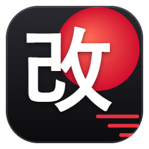

# Kaizen 改善

**Assistant revendeur pour Vinted.** Une extension Chrome qui fait remonter, gère et
analyse un dressing Vinted — sans serveur, sans compte à créer, sans abonnement.

*Kaizen* (改善) veut dire « amélioration continue » en japonais. C'est exactement ce
qu'est ce projet : un outil personnel que je reprends et que j'améliore au fil des
semaines, au rythme de ce dont j'ai besoin quand je vends.

## Pourquoi je l'ai écrit

Sur Vinted, une annonce récente remonte dans les résultats. Les vendeurs republient donc
leurs articles à la main, un par un, tous les jours. Les outils qui automatisent ça
existent, mais ils sont payants et fonctionnent par abonnement.

J'ai voulu comprendre comment ça marchait et le refaire moi-même, gratuitement, en
gardant une règle : **mes données ne sortent pas de mon navigateur**. Il n'y a aucun
serveur dans ce projet. L'extension travaille dans un onglet Vinted ouvert, avec ma
propre session, exactement comme si je cliquais moi-même.

## État du projet

**Version 1.6.0 — en cours d'amélioration.** Ce n'est pas un projet « rendu » : il
fonctionne et je m'en sers, mais j'y ajoute des choses régulièrement. Certaines
fonctions sont utilisées tous les jours, d'autres sont écrites mais jamais essayées en
conditions réelles — c'est signalé noir sur blanc dans la documentation.

## Installation

Il n'y a rien à compiler, ni à installer en dehors de Chrome.

1. Ouvrir `chrome://extensions`
2. Activer **Mode développeur**, en haut à droite
3. Cliquer sur **Charger l'extension non empaquetée**
4. Choisir le dossier du projet, celui qui contient `manifest.json`
5. Épingler l'extension : icône puzzle 🧩 → épingle à côté de « Kaizen »

Après chaque modification du code, cliquer sur ⟳ sur la carte de l'extension.

## Ce qu'il y a pour l'instant

Le socle de l'extension : le manifeste (Manifest V3), le service worker d'arrière-plan,
la petite fenêtre de l'icône et les logos.

La suite arrive au fil des prochaines publications : le pont avec Vinted, la file de
republication, les offres, les messages, le suivi des ventes, le tableau de bord et les
tests automatiques.

## Avertissement

Les conditions d'utilisation de Vinted interdisent l'automatisation. Kaizen est un outil
**indépendant, non affilié à Vinted**, écrit pour un usage personnel. Toutes les
automatisations sont désactivées au départ, avec des pauses, des limites quotidiennes et
un arrêt automatique en cas d'erreur.
